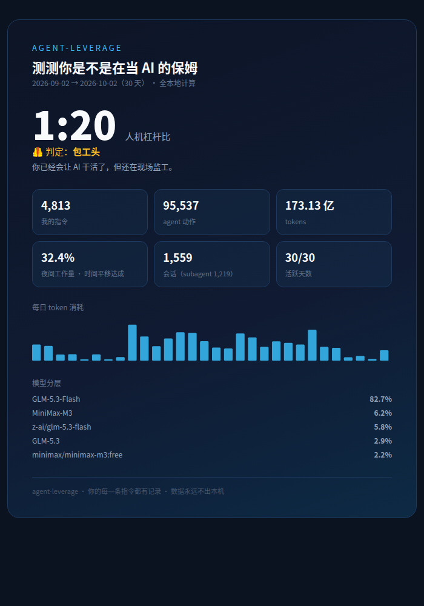

# agent-leverage · 测测你是不是在当 AI 的保姆

一条命令，测出你和 AI agent 的**真实杠杆比**：你敲了多少条指令，agent 们执行了多少个动作。

用 coding agent 的人分两种：一种"我用了 AI，感觉快了一点"，另一种掏出数据——
30 天、4,813 条指令、95,537 次 agent 动作、**1:20 的人机杠杆比**、32.4% 的工作量发生在睡觉时。

别人晒感觉，你晒数据。



## 快速开始

要求：Python 3.8+（**零依赖，纯标准库**），本地有 ZCode 会话数据库。

```bash
git clone https://github.com/<you>/agent-leverage.git
cd agent-leverage

python3 agent_leverage.py                      # 终端报告
python3 agent_leverage.py --html my-card.html  # 生成可截图分享的数据卡
python3 agent_leverage.py --days 14            # 改统计窗口
python3 agent_leverage.py --json out.json      # 原始数据（自己玩花样）
```

数据库不在默认位置时用 `--db /path/to/db.sqlite` 指定。

## 保姆指数对照表

| 人机杠杆比 | 判定 | 说明 |
|---|---|---|
| < 5 | 🧑‍🍼 人肉保姆 | AI 坐在旁边看你干活。它不是不会，是你不让 |
| 5 – 10 | 🧹 贴身管家 | 偶尔舍得放手了，但每一步都要盯——累的是你 |
| 10 – 20 | 🦺 包工头 | 你已经会让 AI 干活了，但还在现场监工 |
| 20 – 50 | 🎖️ 指挥官 | 一条指令 ≈ 几十个动作。产出物不再是代码，是任务定义和验收标准 |
| ≥ 50 | 👻 影子司令官 | 你睡觉的时候它自转。团队里传说中"背后站着 agent"的那个人 |

夜间工作量 ≥ 25% 解锁「时间平移达成」：约 1/3 的工作发生在 22:00–07:00，
晚上布置任务、早晨验收，8 小时工作制的天花板就这么破了。

## 隐私

- 数据库以**只读**模式打开（`mode=ro`），写不进任何一个字节
- 全程无网络请求，报告只存在你本机
- 想分享就截 `--html` 生成的卡，卡上只有数字，没有你的代码

## 指标口径（可复现）

| 指标 | 定义 |
|---|---|
| 我的指令 | `interactive` 会话内 `role=user` 的消息数（fork / subagent 会话里的 user 消息是系统注入或 agent 生成，不计入人类输入） |
| agent 动作 | 全部会话的 `tool_usage` 记录数 |
| 人机杠杆比 | agent 动作 ÷ 我的指令 |
| 夜间工作量 | 本地时间 22:00–07:00 的 token 占比（`computed_total_tokens`，含缓存读写） |
| subagent 占比 | `subagent_child` + `fork` 会话 ÷ 总会话 |
| 消息放大 | 助手消息数 ÷ 我的指令 |

窗口默认最近 30 天，可用 `--days N` 或 `--from/--to` 调整。
注意：本地库一般只保留约 30 天数据，更久的窗口会自动按实际覆盖范围统计并提示。

## 路线图

- [ ] 支持 Claude Code / Codex 等其他本地会话库格式
- [ ] PNG 直接导出（当前用浏览器打开 `--html` 截图即可）
- [ ] 团队版：多人数据聚合，测测谁是全组最大的保姆

## 为什么开源这个

这是《从执行者到指挥官》方法论的第一块拼图：**先测量，再提效**。
你不需要相信任何人的"10 倍"故事，包括作者本人的——跑一下，看自己的数字。

## License

MIT
